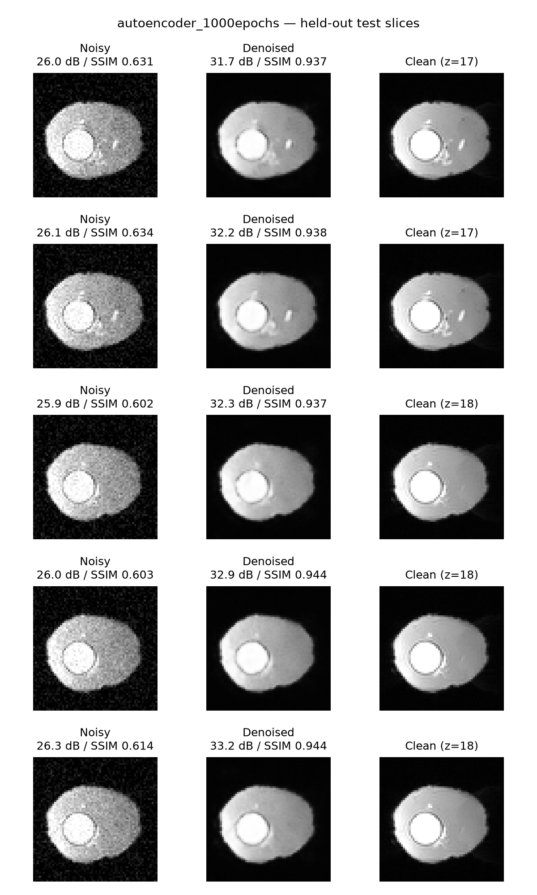
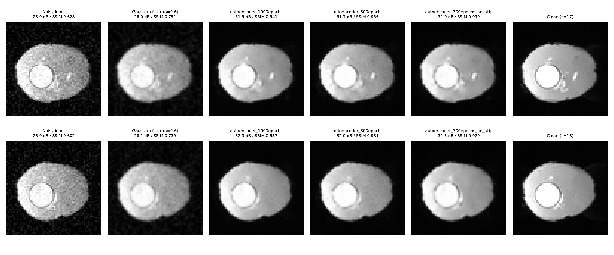
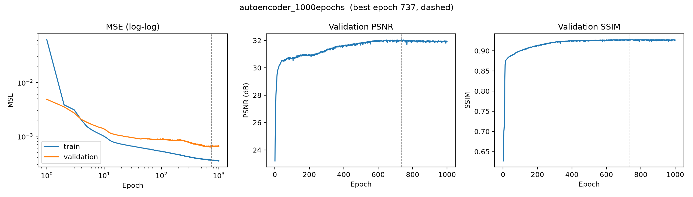
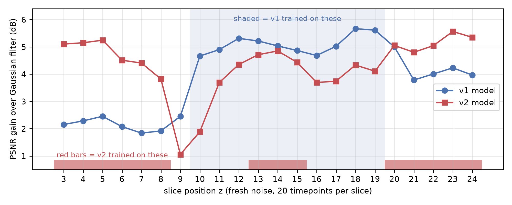

# CNN Denoising of MRI Slices — v2

A small convolutional autoencoder that removes synthetic Gaussian noise from 64×64 EPI BOLD MRI slices,
evaluated on **held-out slice positions** with **PSNR and SSIM** against a classical Gaussian-filter baseline.

This is v2. The original version is preserved at tag [`v1.0`](https://github.com/Vlad2005-dev/cnn-MRI-denoising/tree/v1.0). What changed and why
(full write-up with code and experiments: [`docs/leakage_explained.pdf`](docs/leakage_explained.pdf)):

| | v1 | v2 |
|---|---|---|
| Split | random 80/20 over images | by slice position (z): train / val / test, with buffer slices |
| Test set | none (validation used for everything) | separate held-out test slices, used once |
| Metrics | validation MSE | MSE, PSNR, SSIM (mean ± std per image) |
| Baseline | none | Gaussian filter, σ tuned on validation |
| Checkpoint | last epoch | best validation epoch |

---

## Why v1's numbers were optimistic (data leakage)

The phantom is static for the first ~146 timepoints, and the signal changes by only ~0.5% between timepoints.
So slice *z* at time *t* is practically the same image as slice *z* at any other time. v1's 1000 images were
really **10 distinct slices × 100 noise realisations**, and a random split put near-identical copies of every
validation image into the training set. The validation MSE measured "denoise an image I've already seen",
not "denoise a new image".

v2 assigns each slice position to exactly one split:

| split | z slices | images |
|---|---|---|
| train | 3–8, 13–15, 20–24 | 1400 |
| val | 10, 11 | 200 |
| test | 17, 18 | 200 |
| unused buffer | 9, 12, 16, 19 | – |

Neighbouring slices are ~97% correlated, so the buffer slices keep the closest training slice two positions away.
Intensity-normalisation percentiles are also computed from the training slices only.

**Limitation:** this is one phantom, so all splits share the same object. The test measures generalisation to
unseen *cross-sections*, not to unseen subjects or scanners.

---

## Results (held-out test slices, 200 images)

| method | MSE | PSNR (dB) | SSIM |
|---|---|---|---|
| Noisy input | 0.00249 | 26.04 ± 0.13 | 0.622 ± 0.014 |
| Gaussian filter (σ = 0.6 px) | 0.00149 | 28.28 ± 0.14 | 0.756 ± 0.010 |
| **CNN, with skip connection** (1000 epochs, best = epoch 737) | **0.00058** | **32.42 ± 0.47** | **0.941 ± 0.004** |
| CNN, with skip connection (300 epochs) | 0.00061 | 32.14 ± 0.45 | 0.935 ± 0.004 |
| CNN, no skip connection (300 epochs) | 0.00071 | 31.49 ± 0.44 | 0.932 ± 0.004 |

- The CNN gains **~6.4 dB PSNR** over the noisy input and **~4.1 dB over the best Gaussian filter**.
- The skip connection helps by ~0.65 dB at 300 epochs. The figures show why: without it, fine structures are softer.
- Training to 1000 epochs adds ~0.3 dB over 300. Validation peaks at epoch 737 and then flattens slightly
  while training MSE keeps falling, i.e. the start of overfitting; the best-validation checkpoint is the one kept.
- Full numbers: `results/test_metrics.json`. Training logs: `results/train_log_*.txt`.







The leakage in v1, measured: each model beats the Gaussian filter by ~5 dB on slices it trained on, but only ~3 dB
on slices it never saw (fresh noise in both cases). Details in [`docs/leakage_explained.pdf`](docs/leakage_explained.pdf).



Figures:
- `denoising_examples/denoising_demo_<model>.png`: noisy / denoised / clean for 5 test images, per-image PSNR/SSIM
- `denoising_examples/test_examples.png`: noisy, Gaussian, both CNNs and clean side by side
- `plots/training_curves_<model>.png`: train/val MSE, val PSNR and val SSIM vs epoch

---

## Setup

The base Anaconda env has a broken NumPy/matplotlib combination, so v2 uses its own env:

```
conda create -n cnn-denoising python=3.12
conda activate cnn-denoising
pip install -r requirements.txt
```

## Usage

Run from anywhere (paths are resolved relative to the project):

```
python scripts/make_dataset.py                         # builds data/mri_denoising_split.npz (not in the repo; run this first)
python scripts/train_autoencoder.py --epochs 300       # with skip connection
python scripts/train_autoencoder.py --epochs 300 --no-skip
python scripts/evaluate.py                             # evaluates all models in trained_models/ on the test set
```

Each training run takes ~1 s/epoch on an Apple-silicon GPU (MPS).

## Files

```
cnn-MRI-denoising/
├── data/
│   ├── EPI_Head_ep2d_bold_moco_10.nii.gz   raw 4D NIfTI (64×64×30×300)
│   └── mri_denoising_split.npz             clean, noisy, split, z, t
├── scripts/
│   ├── common.py              model, split loading, PSNR/SSIM, paths
│   ├── make_dataset.py        z-based split + synthetic noise (σ = 0.06)
│   ├── train_autoencoder.py   training, best-val checkpoint, curves
│   └── evaluate.py            test metrics, Gaussian baseline, figures
├── docs/                      leakage write-up (PDF + LaTeX source)
├── trained_models/            *.pt weights + *_history.json per-epoch metrics
├── plots/
├── denoising_examples/
└── results/
```

## Model

Unchanged from v1: two conv layers with max-pooling (1→16→32 channels), bilinear upsampling,
a 32→16 conv, an additive skip connection from the first encoder layer, a 16→1 conv and a sigmoid.
Adam (lr 1e-3), MSE loss, batch size 32.

## Data reference

EPI BOLD data from https://zenodo.org/records/7862046 (`Translation_08mm.tar.gz`); only the first 100
timepoints, before the phantom moves, are used.

Einspänner, E. et al. *Evaluating different methods of MR-based motion correction in simultaneous PET/MR
using a head phantom moved by a robotic system.* EJNMMI Physics, 2022.
